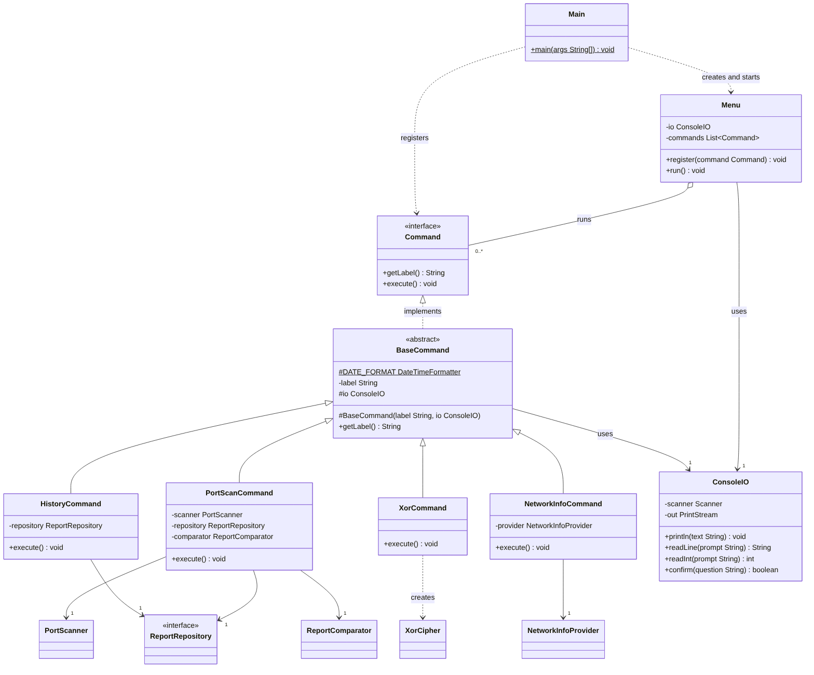
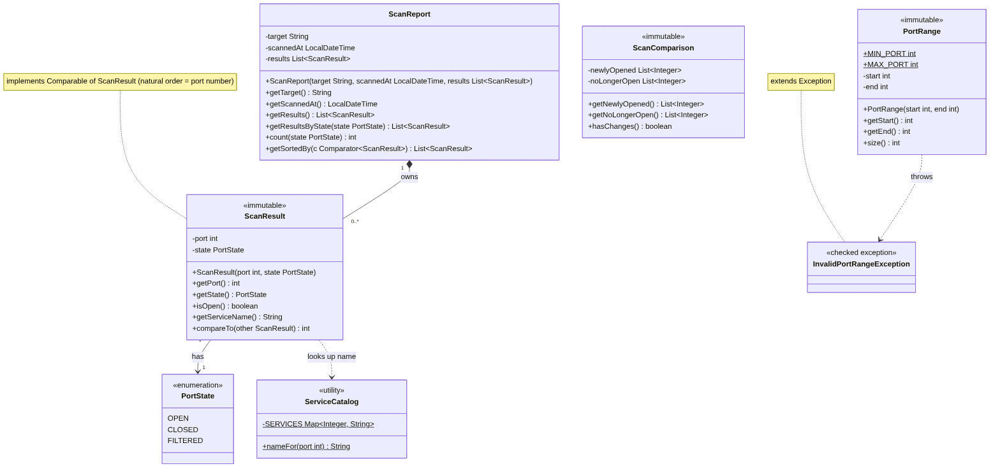
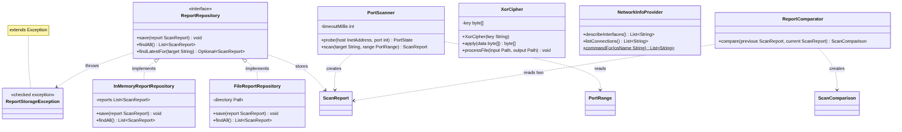

# UML class diagrams

The diagrams show the important classes, interfaces, visibility (`+` public, `-` private, `#` protected), inheritance, realization, and relationships with multiplicities. The editable sources are the `.mmd` files (Mermaid), exported to PNG.

## 1. Commands and user interface (Command pattern)

Source: [class-diagram-commands.mmd](class-diagram-commands.mmd)

## 2. Domain model

Source: [class-diagram-domain.mmd](class-diagram-domain.mmd)

## 3. Services and persistence

Source: [class-diagram-services.mmd](class-diagram-services.mmd)

## Relationship summary

| Relationship | Kind | Multiplicity |
|---|---|---|
| `ScanReport` — `ScanResult` | Composition (the report owns its results) | 1 to 0..* |
| `Menu` — `Command` | Aggregation (commands can exist without the menu) | 1 to 0..* |
| `BaseCommand` — `ConsoleIO` | Association | each command uses 1 console |
| `ScanResult` — `PortState` | Association | each result has 1 state |
| `Command` ← `BaseCommand` ← 4 concrete commands | Realization and inheritance | |
| `ReportRepository` ← `FileReportRepository`, `InMemoryReportRepository` | Realization | |
